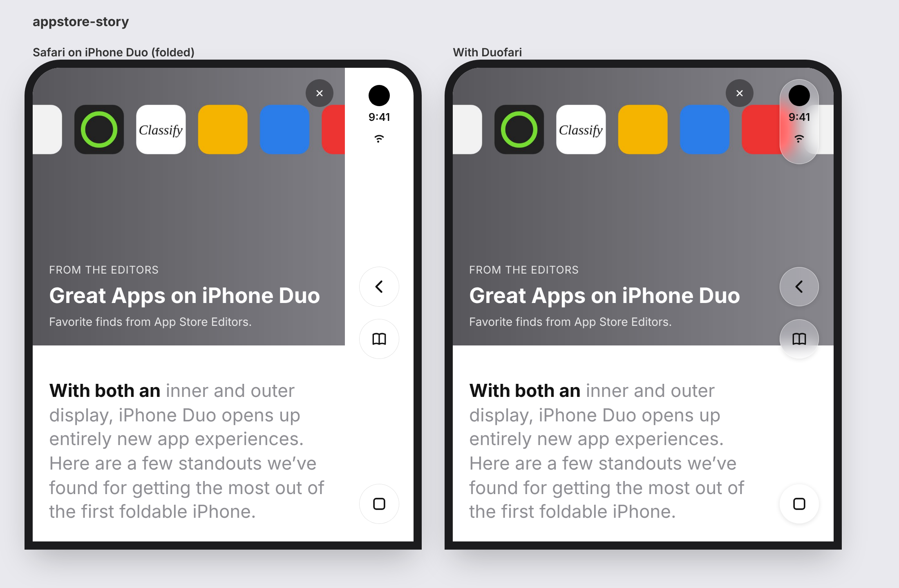
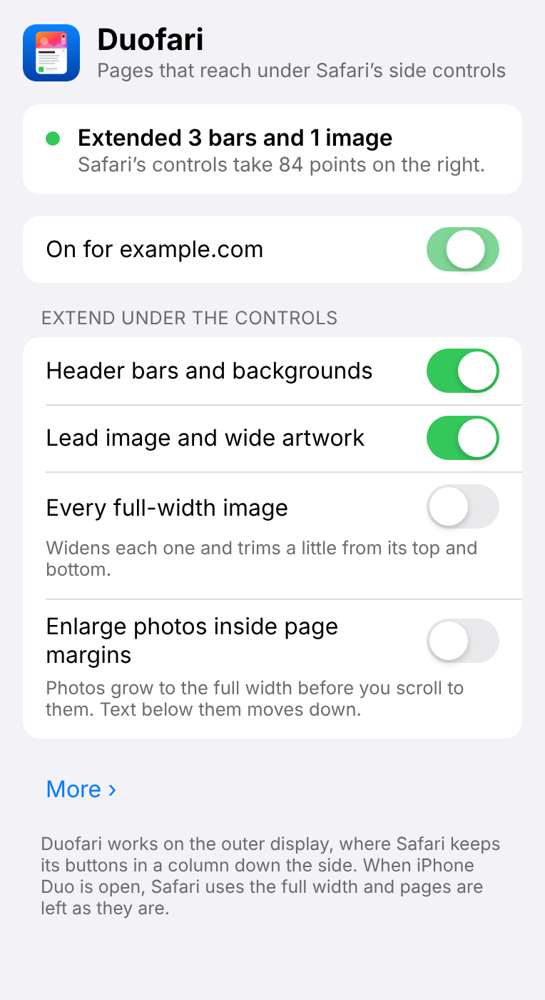

# Duofari

A Safari Web Extension for iPhone Duo. On the folded outer display (466 × 678 pt), Safari keeps
its controls in an 84-pt column on the right, and web pages stop at that column: the page gets a
382 × 580 layout viewport. Apple's own apps on iPhone Duo, such as the App Store's editorial
stories, do it differently. Their header art and backgrounds run under the side column, and text
stays clear of it. Apple's design guidance describes the same pattern: "letting a background image
or header span the full width while scrollable content stays inset." Duofari does this for web
pages. Header bars, hero art and full-width images extend under Safari's column. Text and controls
do not move.



*Left: Safari on the folded iPhone Duo. Right: the same page with Duofari. The fixture tests
rendered this page in Chromium, emulating the folded Duo. Safari's column was drawn onto the
screenshot afterwards, so this is not a device capture. More previews:
[news page](docs/images/news.png), [blog](docs/images/blog.png).*

## What it extends, and what never moves

What extends (each item has a switch in the popup):

| Popup setting | Default | What it does |
|---|---|---|
| **Header bars and backgrounds** | On | Full-width boxes with their own background (header bars, hero sections, banners, footers). The background continues under the column. The content box stays where it was. |
| **Lead image and wide artwork** | On | The lead image near the top of the page, plus cover-fitted pictures and background videos that have cropped-away art to show. |
| **Every full-width image** | Off | Widens each full-width image and trims a little from its top and bottom. |
| **Enlarge photos inside page margins** | Off | Photos inset by page margins grow to the full width before you scroll to them. This is the only setting that changes layout: text below the photo moves down. |

What never moves or extends:

- Text, links, buttons and form controls keep their position (only **Enlarge photos inside page
  margins** pushes text down). The tests check that no text or control moves, sideways or up and
  down.
- Carousel slides, video players and videos with controls, iframes, canvas, SVG and editable
  areas (`contenteditable`) are left alone. Pictures that look like charts, diagrams, maps or
  screenshots (judged by class names, alt text and file type) are never scaled up or trimmed.
- Full-screen fixed overlays (menus, modals) are left alone. Nothing hidden beside the viewport,
  such as an off-canvas menu, is revealed.
- The page does not scroll sideways. See "Hold pages steady" below.

How it works, in short (details in [docs/DESIGN.md](docs/DESIGN.md)):

- **Finding the column.** There is no web API for it, and `env(safe-area-inset-right)` reports 0
  in Simulator measurements. Duofari recognises iPhone Duo by its screen aspect ratio (678/466)
  and a pixel ratio of 2.5 or more. The column width is the screen width minus the layout width times the zoom scale
  (466 − 382 = 84 in portrait). Duofari acts only when this is between 60 and 110 pt. When
  Safari's fingerprinting protection hides the screen size (as in Private Browsing), it uses the
  size the containing app reports through native messaging.
- **Extending a box.** A transparent border (or padding) on the column side plus an equal
  negative margin grows the painted box by the column width while the content box stays put.
  Every change is measured and rolled back if content moved. Fixed bars also get an identity
  `translate`: going by WebKit's source, that lets them paint past the layout viewport (not yet
  confirmed on a device). On pages whose own content fits, `initial-scale=1` and
  `minimum-scale=1` are added to the viewport meta where they are missing, and the minimum is
  raised to 1 where the page allows less, so neither Safari nor the reader zooms out over the
  wider content. If the page's own initial scale is below 1, the minimum scale is set to that
  instead.
- **Clean undo.** Changes are inline styles with the originals saved. Turning Duofari off puts
  the originals back; on an element it extended, a value the page set itself in the meantime is
  kept. A modal's scroll lock that writes Duofari's own padding or margin back, as Bootstrap's
  does, doesn't count as the page's value. The copy Bootstrap 5 keeps for when the modal closes
  is pointed back at the page's own value, or removed if the page had none. Copies the page
  makes of changed or locked elements (such as sticky-header clones) are cleaned up as soon as
  they appear, even while Duofari is off.

## Where it works

| Situation | What Duofari does |
|---|---|
| Folded, portrait | Active. The column is on the right and is measured at runtime. |
| Folded, landscape | Which side the column is on has not been confirmed. With **Auto**, Duofari guesses the side from the screen orientation and extends only backgrounds, no images. Pick **Left** or **Right** to extend images too; a column on the page's start side is still left alone (see below). |
| Unfolded (inner display, full screen) | Idle. Safari has no column at full screen on the inner display. Split View on the inner display has not been measured. |
| The column on the page's start side: right-to-left pages in portrait, or left-to-right pages with the column on the left in landscape | Left alone. A page can only paint past its end edge. |
| Desktop-layout pages (no viewport meta, or a fixed width wider than the screen) | Skipped unless **Also adjust desktop-layout pages** is on. |
| Reduce Transparency | Stands down when `prefers-reduced-transparency: reduce` matches. |
| Safari's own pages (such as the Start Page), Reader, PDFs, and files such as an SVG image opened on their own | Not changed. Duofari works on web pages only, and the popup says so. |
| Built-in list of web apps (Google Docs, Figma, Slack and others in `extension/shared-settings.js`) | Off by default. You can turn it on per site. |
| Other iPhones | Idle. |

## Requirements

- iPhone Duo with iOS 27. The project's deployment target is iOS 27.0, iPhone only.
- To build: a Mac with Xcode 27.1 or later, which includes the iPhone Duo Simulator, and Python 3.
- To run the tests: Node.js 22 or later. Playwright 1.63 is installed by `npm install`.

## Build and run

1. Generate the Xcode project with your team ID and bundle ID. The extension's bundle ID gets
   `.Extension` appended.

   ```sh
   python3 scripts/gen-xcodeproj.py --team ABCDE12345 --bundle-id com.yourname.Duofari
   ```

   The checked-in project uses `com.example.Duofari`, no team and build number 1. `--version`
   defaults to the version in `extension/manifest.json`. `npm run xcodeproj -- …` runs the same
   script. Run it again after adding or removing files in `extension/` or `apple/`.
2. Open `apple/Duofari.xcodeproj`. Choose the **Duofari** scheme and an iPhone Duo or the iPhone
   Duo Simulator, then run.
3. The Duofari app shows whether the extension is on, and has an **Open Settings** button. Turn it
   on the way the app describes:
   1. Open **Settings > Apps > Safari > Extensions > Duofari**.
   2. Switch on **Allow Extension**. Do the same for each Safari profile you use, and for
      **Private Browsing** if you want it there too.
   3. Under **Permissions**, set **All Websites** to **Allow**.
   4. Reload any tabs that were already open.

## Using it



Tap the extensions button in Safari and choose Duofari. The popup shows:

- **Status.** What Duofari did on this page, for example "Extended 3 bars and 1 image" and "Safari’s
  controls take 84 points on the right". When it does nothing, the popup says why: not an iPhone
  Duo, desktop layout, controls on the wrong side, Reduce Transparency, and so on.
- **Site access.** If Duofari can't see the site, **Allow on All Websites** asks Safari for
  access to all websites, then runs Duofari on the page. Opening the popup also gives Duofari
  access to the open page, but only until the tab goes to another site. The popup then shows the
  page's status with "For now Duofari can see only this page" and the same button. If the page
  was opened before Duofari was on, **Apply to This Page** runs it without a reload. Where
  Duofari can't run (Safari's own pages, PDFs), the popup says so and never reloads the page.
- **On for *site*.** Turns Duofari off or on for the current site.
- **Extend under the controls.** The four settings in the table above.
- **More:**
  - **Safari’s controls in landscape:** Auto, Left or Right.
  - **Hold pages steady:** on by default. It sets `touch-action: pan-y pinch-zoom` on `html`,
    `body` and scrolling wrappers, so the page can't be dragged sideways. Where the page set a
    `touch-action` of its own, Duofari only takes sideways panning out of it, so anything the
    page turned off (pinch-zoom, say) stays off. Wrappers that scroll sideways themselves, such
    as carousels, keep their panning. The lock comes off while you're pinch-zoomed in, and it
    isn't set on pages that can scroll sideways by themselves. Turn it off to keep double-tap
    zoom and swiping back from the middle of a page. Pages then slide back after scrolling
    settles.
  - **Also adjust desktop-layout pages.**
  - **Show what’s extended:** outlines extended elements and hatches the column.
  - **Duofari on all websites:** the main switch.
  - **Diagnostics:** technical details for a bug report, with a **Copy** button.

<br clear="right">

## Testing

```sh
npm install
npx playwright install chromium
npm test              # unit, fixture, regression and popup tests
npm run test:live     # 16 live websites (needs network)
```

- `npm run test:unit`: 22 tests with `node:test`. `test/unit/geometry.test.mjs` (20 tests)
  covers the column measurement and the per-site switch. `test/unit/background.test.mjs`
  (2 tests) checks that the background script stores the device the app reports, and rewrites
  it only when the answer changes.
- `npm run test:fixtures`: `test/run-fixtures.mjs` runs 26 cases against the pages in
  `test/fixtures/`. It emulates the folded Duo (viewport 382 × 580, screen 466 × 678, DPR 3);
  a few cases use landscape, unfolded or an ordinary iPhone instead.
  It checks pixels under the column and these invariants: no text, control or pseudo-element
  moves, nothing hidden is revealed, no sideways scroll, and a clean revert (apart from the
  single-page-app case, the DOM is the same byte for byte after turning Duofari off). Pass
  case names to run only some cases: `node test/run-fixtures.mjs blog news`.
- `npm run test:regressions`: `test/run-regressions.mjs` runs 71 cases, each built around one
  defect found in review, and checks the behaviour its fix restored. Pass names to run only
  some: `node test/run-regressions.mjs engine-4`.
- `npm run test:popup`: 15 popup states with a mocked browser API, including the site access
  states, PDFs and Safari's Start Page.
- `npm run test:live`: the same invariants on live sites, and that turning Duofari off puts back
  every element it changed, the touch settings of `html` and `body`, and the viewport meta;
  `node test/run-live.mjs https://…` tests specific pages. Previews and reports go to
  `test/output/`.

Emulation can't show what Safari really paints. To check a device, run `node test/serve.mjs`
(optional port, default 8080) and open the printed `http://<address>:8080/device/` in Safari on
iPhone Duo, on the same Wi-Fi network. In the Simulator, `localhost` works too. The page tests
painting under the column, fixed bars, the other side, sideways scrolling, and rotating and
unfolding. **Copy report** copies the results. See [docs/TESTING.md](docs/TESTING.md).

## Packaging

```sh
npm run package
```

This writes `dist/Duofari-<version>.zip` from `extension/`. First it checks that every file
`manifest.json` refers to exists and that every JSON file parses. The zip is byte-for-byte
reproducible. The Xcode project bundles the same `extension/` folder.

App Store Connect needs a higher build number for each upload. Regenerate the project with
`--build`, for example:

```sh
python3 scripts/gen-xcodeproj.py --team ABCDE12345 --bundle-id com.yourname.Duofari --build $(git rev-list --count HEAD)
```

See [docs/APPSTORE.md](docs/APPSTORE.md).

## Repository layout

```
extension/            MV3 web extension (the code that runs in Safari)
  manifest.json
  shared-settings.js  settings defaults, built-in excluded web apps, per-site on/off
  content-geometry.js detects the column: width, side, landscape, RTL, desktop layout
  content-bleed.js    extends a box under the column without moving its content; exact restore
  content-classify.js decides what is a band or media; skips carousels, players, graphics
  content-guard.js    holds the page still horizontally
  content-main.js     controller: scheduling, viewport meta, observers, SPA navigation, popup status
  background.js       asks the containing app for the real screen size
  popup.html/.css/.js the popup
  _locales/en/        strings
apple/                SwiftUI containing app, extension target, Duofari.xcodeproj
scripts/              gen-xcodeproj.py, package.mjs, build-icons.mjs, build-fixture-images.mjs, icon SVGs
test/                 unit tests, fixture/regression/popup/live runners, lib/duo.mjs emulation, device/ check page
docs/                 DESIGN.md, TESTING.md, APPSTORE.md, images/
```

## Known limitations

- **Not verified on iPhone Duo hardware.** Everything was tested in Playwright/Chromium emulation
  and checked against WebKit source and other developers' simulator reports. Use `test/device/` on
  a device or in the Xcode 27.1 Simulator to check real painting under the column, the fixed-bar
  lift, touch behaviour, and Safari's opaque fill: WebKit's `fixedContainerEdges` sampler covers
  the column with one solid colour when a fixed or sticky box spans 90% or more of the right edge.
- **End edge only.** Pages can only paint toward their end edge, which is the right edge in
  left-to-right pages. So right-to-left pages in portrait, and left-to-right pages with the
  column on the left in landscape, are left alone.
- **Landscape side unconfirmed.** Nobody has confirmed which side the column is on in landscape.
  So **Auto** extends only backgrounds (no images) in landscape, and you can pick the side.
- **Unfolded: idle.** Safari has no column on the unfolded inner display at full screen.
- **Hold pages steady** turns off double-tap zoom and swiping back from the middle of a page. You
  can turn it off; pages then snap back after scrolling.
- **Reduce Transparency** is detected with `matchMedia('(prefers-reduced-transparency: reduce)')`
  as future-proofing. Whether Safari exposes this setting is unverified.
- **Desktop-layout pages** (no viewport meta, or one wider than the screen) are skipped unless
  **Also adjust desktop-layout pages** is on.
- **Top frame only.** Content inside iframes is not changed.
- **Pages that keep resizing.** If Duofari has to switch on and off more than 4 times within 10
  seconds on a page, it pauses there. The popup says "Paused on this page". Folding, unfolding
  and rotating don't count. Changing a setting, or going to another page (in a single-page app
  too), gives the page a fresh start.
- **Pages that rewrite their viewport meta.** Duofari puts its additions back at most 5 times in
  10 seconds. A page that rewrites it more often than that keeps its own meta, and Safari may
  then zoom the page out to fit the extended content.
- **Pinch-zoomed in.** While you're zoomed in, Duofari keeps the page as it was and doesn't
  measure it again until you zoom back out. A page that was already zoomed in when Duofari
  started is left unchanged until then; the popup says "Paused while zoomed in". If Duofari
  wasn't working on the page and you fold, unfold or rotate while zoomed in, the popup says the
  same until you zoom back out. A reason that folding or turning can't change, such as "Not an
  iPhone Duo", "Reduce Transparency is on" or "Off for this site", stays. If Duofari was working
  on the page, folding, unfolding or rotating while zoomed in undoes its changes at once, and it
  measures the page again once you zoom back out.

## Privacy

Duofari collects no data. It runs on your iPhone, stores its settings in the extension's local
storage, and sends nothing anywhere. It asks the containing app for one thing: the screen size,
scale and model. It uses the size and scale to detect the column. It needs access to all
websites so it can adjust pages as they open. See [PRIVACY.md](PRIVACY.md).

## More documentation

- [docs/DESIGN.md](docs/DESIGN.md): how detection, extension and the page guard work
- [docs/TESTING.md](docs/TESTING.md): the test suites and the device check
- [docs/APPSTORE.md](docs/APPSTORE.md): App Store submission
- [SUPPORT.md](SUPPORT.md): help and bug reports
- [PRIVACY.md](PRIVACY.md): privacy policy

## Sources

Research as of 2026-10-23, launch day. No hardware measurements had been published. Every Safari
measurement in this README comes from the Xcode 27.1 Simulator.

Apple:
- iPhone Duo, prepare your apps: https://developer.apple.com/iphone-duo/prepare/
- Human Interface Guidelines, designing for iPhone Duo: https://developer.apple.com/design/human-interface-guidelines/designing-for-iphone-duo
- Preparing your app for iPhone Duo: https://developer.apple.com/documentation/technologyoverviews/preparing-your-app-for-iphone-duo
- Tech Talks: https://developer.apple.com/videos/play/tech-talks/111461/ , https://developer.apple.com/videos/play/tech-talks/111462/ , https://developer.apple.com/videos/play/tech-talks/111466/
- Developer Forums (Safari disables the vertical bar at regular width; web detection of iPhone Duo): https://developer.apple.com/forums/thread/847864 , https://developer.apple.com/forums/thread/847644
- iPhone Duo technical specifications: https://support.apple.com/en-us/148588
- Safari tab layouts on iPhone: https://support.apple.com/guide/iphone/change-the-layout-ipha9ffea1a3/ios
- Packaging and distributing Safari Web Extensions with App Store Connect: https://developer.apple.com/documentation/safariservices/packaging-and-distributing-safari-web-extensions-with-app-store-connect
- App Store story: https://apps.apple.com/us/iphone/story/id6820639500

WebKit:
- Source on `main` (https://github.com/WebKit/WebKit): `LocalFrameView.cpp` (`fixedContainerEdges`),
  `WKWebView.mm` and `WKWebViewIOS.mm` (colour extension views, `env()` insets),
  `ViewportConfiguration.cpp`, `Document.cpp`, `UnifiedWebPreferences.yaml`
- Commits and bugs: https://commits.webkit.org/318137@main (https://bugs.webkit.org/show_bug.cgi?id=317336),
  https://commits.webkit.org/322993@main (https://bugs.webkit.org/show_bug.cgi?id=325161), https://commits.webkit.org/323738@main ,
  https://commits.webkit.org/322390@main , https://commits.webkit.org/323006@main , https://commits.webkit.org/324198@main

Measurements and write-ups:
- Mike Piontek, Safari on iPhone Duo (Xcode 27.1 Simulator): https://mikepiontek.com/journal/iphone-duo-safari.html
- fold-ready measurements: https://dev.to/tyoukyou23/i-measured-what-safari-actually-gives-your-web-page-on-iphone-duo-8jp , https://github.com/tyoukyou23/fold-ready
- render-harness: https://github.com/Ahmed-Badr00/render-harness/pull/2
- Blake Crosley, iPhone Duo Simulator: https://blakecrosley.com/blog/xcode-27-1-beta-iphone-duo-simulator
- getchonky, screen sizes: https://getchonky.app/blog/iphone-duo-screen-sizes/
- safearea.info: https://safearea.info/iphone-duo
- Clydara, web checklist: https://dev.to/clydaralab/the-iphone-duo-web-checklist-9-things-to-verify-before-october-23-54mk
- Firefox for iOS, vertical bar support: https://github.com/mozilla-mobile/firefox-ios/pull/36231
- 9to5Mac review: https://9to5mac.com/2026/10/21/iphone-duo-review/
- Similar extensions (closed source): Widen https://github.com/pedantique/widen-site , OutSpan https://www.outspan.app/ , Wider https://www.getwider.app/
